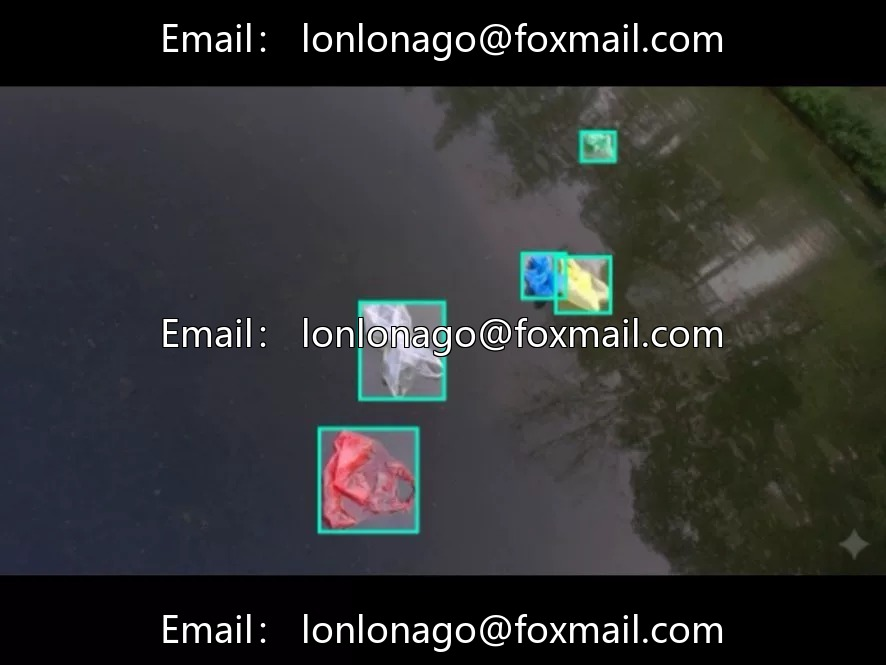
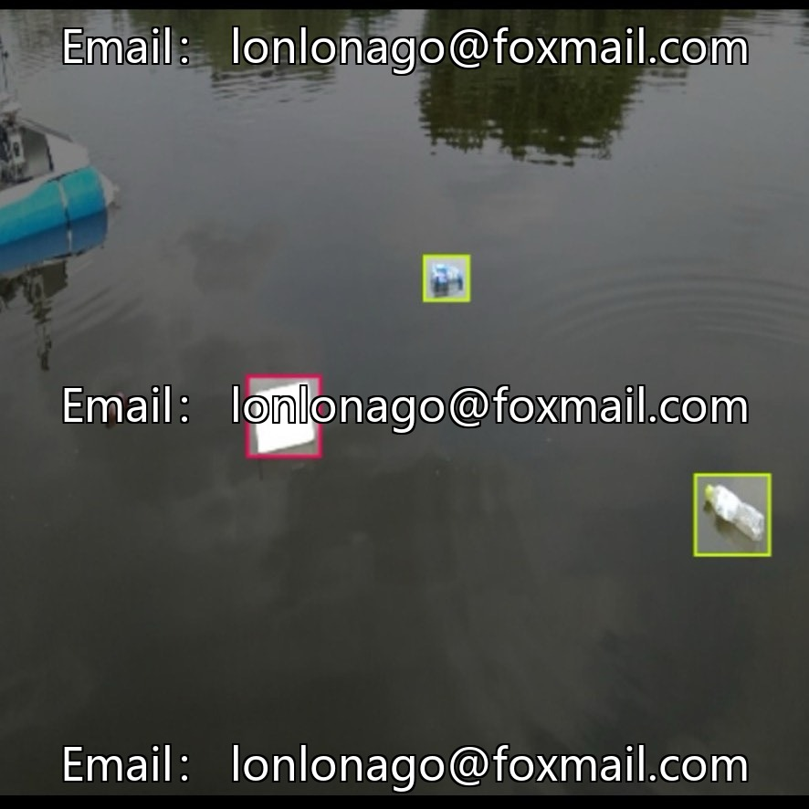
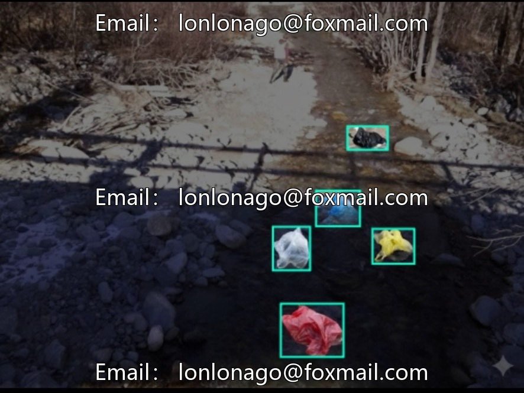

# Dataset 10384: River Pollution and Waste Identification, 2200 images, 6 categories

## Body

Dataset 10384: River Pollution and Garbage Identification, comprising 2200 images, covering six common types of garbage (bottles, branches, cans, milk cartons, plastic bags, plastic waste), labeled in YOLO format. Suitable for drone inspection, intelligent garbage classification, environmental monitoring, etc. The data covers various angles and lighting conditions, closely aligned with outdoor realities, directly importable for training in mainstream detection frameworks.

Virtual materials, once sold, are non-refundable.
Interested friends, click "I want" to proceed.

## Images

## Payment

Here is a pay link on Stripe ( https://buy.stripe.com/3cs8yP7sY87d0vu9AB ). Please contact me lonlonago@foxmail.com after funding $89, and I will send you a complete data files , thank you!

